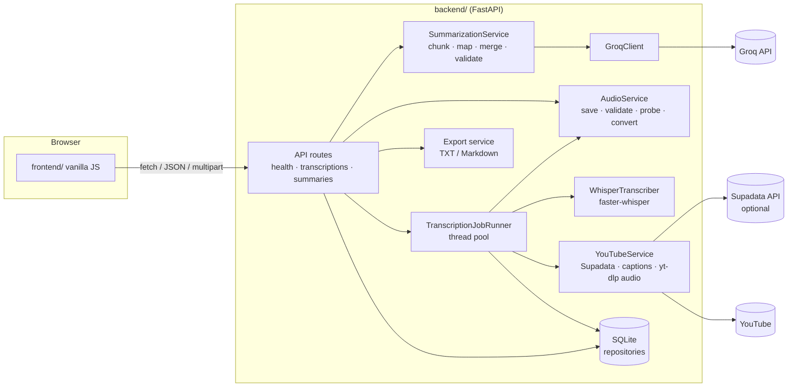

<div align="center">


# Transmint

**Turn meeting recordings, lectures and YouTube videos into transcripts and structured summaries.**

[](https://transmint.vercel.app)
[](https://transmint.onrender.com/docs)
<br/>


[**Try it live**](https://transmint.vercel.app) · [Run it locally](#-how-to-run-locally-step-by-step) · [Deploy](#%EF%B8%8F-deployment) · [API reference](#-api-reference)

</div>

---

## ✨ Overview

| | |
| --- | --- |
| 📥 **Input** | An audio file upload **or a YouTube link**. For YouTube, Transmint uses the video's own captions when they exist, and otherwise downloads just the audio and transcribes it. No YouTube API key is needed. On cloud hosts where YouTube blocks the server, captions can be fetched through the optional [Supadata](https://supadata.ai) API. |
| 📝 **Transcription** | Runs on the backend itself with [faster-whisper](https://github.com/SYSTRAN/faster-whisper). No audio is sent to a third-party transcription API; when you run the backend locally, no audio leaves your machine. |
| 🧠 **Summarization** | Uses the [Groq](https://console.groq.com) API to produce validated, structured summaries: an overview, key points, concepts, decisions, suggestions, action items, follow-up questions and unclear parts. |

The project has two independent parts:

| Folder | What it is | Deployed at |
| --- | --- | --- |
| [`backend/`](backend/) | Python FastAPI service: uploads, background transcription jobs, summarization, SQLite storage, exports. Usable on its own via REST or `/docs`. | [transmint.onrender.com](https://transmint.onrender.com/docs) (Render) |
| [`frontend/`](frontend/) | A minimal vanilla HTML/CSS/JS demo client. No framework or build step. | [transmint.vercel.app](https://transmint.vercel.app) (Vercel) |

> [!TIP]
> **Just want to use it?** Open **<https://transmint.vercel.app>**.
> **Want to run it yourself?** Go to [How to run locally](#-how-to-run-locally-step-by-step).

## 📑 Contents

- [Features](#-features)
- [Architecture](#%EF%B8%8F-architecture)
- [Tech stack](#-tech-stack)
- [Prerequisites](#-prerequisites)
- [How to run locally (step by step)](#-how-to-run-locally-step-by-step)
- [Troubleshooting](#-troubleshooting)
- [Configuration](#%EF%B8%8F-configuration)
- [Deployment](#%EF%B8%8F-deployment)
- [API reference](#-api-reference)
- [Tests](#-tests)
- [Security notes](#-security-notes)
- [Known limitations (V1)](#%EF%B8%8F-known-limitations-v1)
- [Future improvements](#-future-improvements)

---

## 🚀 Features

**Input**
- 🔗 Paste a YouTube link (`watch`, `youtu.be`, `shorts`, `live`, `embed`). Captions are tried first because they are instant and often more accurate; videos without captions fall back to audio download plus Whisper. The video title and duration are recorded.
- ☁️ Optional [Supadata](https://supadata.ai) integration (`SUPADATA_API_KEY`): captions are fetched from Supadata's servers, so YouTube links work on cloud hosts such as Render, where YouTube blocks the server's IP with a bot check.
- 🎧 Upload WAV, MP3, M4A, FLAC, OGG or WebM audio (checked by extension, file signature and a real decode probe, with a size limit).

**Transcription**
- ⏳ Background transcription jobs (`queued → processing → completed | failed`) with a status endpoint for polling.
- 🕒 Transcript with detected language, duration and timestamped segments.

**Summarization**
- 📋 Three summary types: `brief`, `detailed` and `meeting_notes`, plus an optional output language.
- 🧩 Long transcripts are split into chunks and summarized hierarchically (map → merge), so no single prompt is oversized.
- 🛡️ A careful prompt that treats the transcript as untrusted data, keeps decisions separate from suggestions, and never invents owners or deadlines. A post-check also removes owners/deadlines that don't appear in the transcript.
- ✅ Every LLM response is validated against a Pydantic schema, with one automatic repair attempt.

**Output & errors**
- 💾 TXT and Markdown export for transcripts and summaries.
- 🚦 Clear HTTP errors for invalid files, missing dependencies or credentials, upstream rate limits and timeouts.

---

## 🏗️ Architecture



### Request flow

1. **Upload.** `POST /api/transcriptions` streams the upload to `backend/data/uploads/<uuid>.<ext>`, validates it, creates a `queued` record and returns `202` right away.
2. **Transcribe.** A worker thread marks the job `processing`, transcribes it, stores the result (`completed`) or the error (`failed`), and **always deletes the temporary file**.
   - *For a YouTube link* (`POST /api/transcriptions/youtube`), the worker first tries the video's caption track: through Supadata when `SUPADATA_API_KEY` is set (one transcript request per job; long videos are processed as a Supadata job that is polled every 2 seconds for up to 3 minutes), then directly from YouTube. If there is none, it downloads the audio-only stream into the same temporary folder and transcribes it like an upload.
3. **Poll.** The client polls `GET /api/transcriptions/{id}/status`, then fetches the full record.
4. **Summarize.** `POST /api/summaries` loads the transcript, chunks it if needed, calls Groq, validates the JSON and stores the summary.

> [!NOTE]
> All SQL is isolated in `backend/app/db/`, so the storage can move to PostgreSQL later without changing routes or services.

---

## 🧰 Tech stack

| Area | Tools |
| --- | --- |
| Backend | Python 3.11 to 3.13 (tested on 3.12), FastAPI, Uvicorn, Pydantic v2, pydantic-settings |
| Transcription | faster-whisper 1.2 (CTranslate2), with PyAV for decoding (FFmpeg libraries bundled) |
| Summarization | Groq Python SDK (default model `openai/gpt-oss-120b`; configurable) |
| YouTube | yt-dlp and youtube-transcript-api, plus httpx for the optional Supadata API |
| Storage | SQLite (Python standard library) |
| Tests | Pytest (httpx's mock transport fakes Supadata) |
| Frontend | Vanilla HTML, CSS and JavaScript |
| Hosting | Backend on Render, frontend on Vercel |

---

## 📦 Prerequisites

| Requirement | Details |
| --- | --- |
| **Python 3.11, 3.12 or 3.13** | Python 3.14 may not have wheels for all dependencies yet. |
| **A Groq API key** | For summaries. You can get one free at <https://console.groq.com/keys>. Transcription works without it. |
| **Internet access on the first transcription** | To download the Whisper model from Hugging Face (~145 MB for `base`). After that it is cached. |
| **[Deno](https://deno.com)** *(recommended for YouTube)* | `brew install deno`. yt-dlp uses a JavaScript runtime to solve YouTube's player challenges; Node.js 22+ or Bun also work. Without one, downloads may still work, but some formats can be missing. Caption fetching doesn't need it. |
| **FFmpeg CLI** *(optional)* | PyAV, installed automatically, ships the FFmpeg libraries and decodes all the supported formats. If `ffmpeg`/`ffprobe` are on your `PATH`, Transmint also uses them as a fallback for files PyAV can't open (`brew install ffmpeg` / `sudo apt install ffmpeg`). |
| **A Supadata API key** *(optional)* | From <https://supadata.ai> (free tier available). Not needed locally; recommended when the backend is deployed to a cloud host. See [Deployment](#%EF%B8%8F-deployment). |

---

## 💻 How to run locally (step by step)

You will use **two terminals**: one for the backend (API) and one for the frontend (web page).

### Step 1 · Check the prerequisites

```bash
python3.12 --version        # Python 3.11, 3.12 or 3.13 is required (3.14 is not supported yet)
```

- macOS: `brew install python@3.12` if it's missing. Windows/Linux: install Python 3.12 from <https://www.python.org/downloads/>.
- Optional, for reliable YouTube downloads: `brew install deno` (or see <https://deno.com>).
- Optional: `brew install ffmpeg`, only needed for unusual audio files.
- A free Groq API key from <https://console.groq.com/keys>, for summaries.

### Step 2 · Get the code

```bash
git clone https://github.com/anikchand461/transmint.git
cd transmint
```

### Step 3 · Install the backend *(one time)*

```bash
cd backend
python3.12 -m venv .venv
source .venv/bin/activate          # Windows: .venv\Scripts\activate
pip install --upgrade pip
pip install -r requirements.txt
```

Your prompt should now start with `(.venv)`.

### Step 4 · Configure your API key *(one time)*

```bash
cp .env.example .env               # Windows: copy .env.example .env
```

Open `backend/.env` in an editor and set your key:

```env
GROQ_API_KEY=gsk_your_real_key_here
GROQ_MODEL=openai/gpt-oss-120b
```

Leave everything else as it is. All other settings have working defaults; see [Configuration](#%EF%B8%8F-configuration).

### Step 5 · Start the backend *(terminal 1)*

```bash
cd backend                         # from the project root
source .venv/bin/activate
uvicorn app.main:app --reload --port 8000
```

Wait for `Application startup complete.`, then check it in a browser:

- <http://127.0.0.1:8000/api/health> should show `"status":"ok"` and `"summarization_configured":true`
- <http://127.0.0.1:8000/docs> shows the interactive API documentation

> [!NOTE]
> `http://127.0.0.1:8000/` itself returns `{"detail":"Not Found"}`. That is expected, because the API lives under `/api/...`. Keep this terminal open.

### Step 6 · Start the frontend *(terminal 2)*

Open a **second** terminal and run the server **from inside the `frontend` folder**:

```bash
cd frontend                        # from the project root
python3 -m http.server 5500
```

Or, from any folder: `python3 -m http.server 5500 --directory /path/to/transmint/frontend`.

> [!WARNING]
> Don't just double-click `index.html`. Pages opened from `file://` are blocked by the backend's CORS rules.

### Step 7 · Open the app

> [!IMPORTANT]
> The frontend points to the **deployed** backend (`https://transmint.onrender.com`) by default. To use your **local** backend, open
> **<http://127.0.0.1:5500/?api=http://127.0.0.1:8000>**, or switch the commented `DEFAULT_API_BASE_URL` line at the top of [`frontend/script.js`](frontend/script.js) back to `http://127.0.0.1:8000`.

The line under the title should say **"Backend 0.1.0 connected at http://127.0.0.1:8000"**.

### Step 8 · Use it

1. **Choose an input**
   - **Audio file:** pick or drag a WAV, MP3, M4A, FLAC, OGG or WebM file (up to 100 MB).
   - **YouTube link:** paste a video URL. Keep *"Use the video's captions when available"* ticked for speed, or untick it to always transcribe the audio with Whisper.
2. Click **Transcribe** and wait for the transcript. The **first** run downloads the Whisper model (~145 MB), so it is slower.
3. Pick a summary type (**Brief**, **Detailed** or **Meeting Notes**). Optionally type an output language such as `English`, which is useful for Hindi or other non-English videos.
4. Click **Summarize**. Long videos can take about a minute.
5. Use the **Download** buttons to save the transcript or summary as TXT or Markdown.

### Stopping and restarting

- Stop either server with `Ctrl+C` in its terminal.
- **After editing `backend/.env`, restart the backend** (`Ctrl+C`, then run `uvicorn` again). `--reload` only watches `.py` files, so it won't pick up `.env` changes.
- Next time you only need Step 5 and Step 6. Installation and configuration are one-time.

### Running the tests

```bash
cd backend
source .venv/bin/activate
pytest
```

---

## 🩺 Troubleshooting

| Problem | Cause and fix |
| --- | --- |
| `Address already in use` / port 8000 busy | Another program uses the port. Find it with `lsof -nP -iTCP:8000 -sTCP:LISTEN` and stop it, **or** start the backend on another port (`--port 8001`) and open the page as `http://127.0.0.1:5500/?api=http://127.0.0.1:8001`. |
| Browser shows **"Error response 404 – File not found"** on port 5500 | The frontend server was started in the wrong folder. Stop it and run `python3 -m http.server 5500` **inside `frontend/`**. |
| Page says **"Cannot reach the backend…"** | The backend isn't running, runs on a different port (use `?api=`), or the page's address isn't in `ALLOWED_ORIGINS` in `backend/app/main.py`. Use `http://127.0.0.1:5500` or `http://localhost:5500`, not `file://` or `[::]`. On the deployed Render backend, the first request after it has been idle can take up to a minute. |
| Local page connects to `transmint.onrender.com` instead of your local backend | The frontend defaults to the deployed backend. Open the page with `?api=http://127.0.0.1:8000`, or change `DEFAULT_API_BASE_URL` in `frontend/script.js`. |
| **"summarization not configured (set GROQ_API_KEY)"** although the key is set | The backend was started before the key was added. Restart it. Also check that the key is in `backend/.env`, not in the project root. |
| **"Groq model '…' is not available"** | Groq retired that model. Set `GROQ_MODEL` in `backend/.env` to a current one from <https://console.groq.com/docs/models> (default: `openai/gpt-oss-120b`) and restart. |
| **"Groq rate limit reached"** (429) | The free-tier limit was hit. Wait a minute and try again. |
| First transcription is slow or fails offline | The Whisper model downloads on first use and needs internet once. |
| YouTube: **"asking for a sign-in/bot check"** | Export your browser's YouTube cookies to `cookies.txt` and set `YTDLP_COOKIES_FILE=/path/to/cookies.txt` in `backend/.env`, then restart. On cloud hosts (Render etc.), set `SUPADATA_API_KEY` instead so captions are fetched via Supadata. |
| YouTube still fails with `SUPADATA_API_KEY` set | Check the backend logs for `Supadata returned HTTP …`: `401` means a wrong key, `429` means the credit limit was used up. With `SUPADATA_MODE=native`, videos without captions fall back to the audio download, which a cloud host may still block; use `SUPADATA_MODE=auto` to have Supadata generate a transcript instead. |
| YouTube downloads fail after a while | YouTube changed something. Run `pip install -U "yt-dlp[default]"` in the backend venv and restart. Installing Deno also helps. |
| `pip install` fails building packages | You're probably on Python 3.14. Recreate the venv with `python3.12 -m venv .venv`. |

---

## ⚙️ Configuration

All settings are environment variables, read from `backend/.env` (or from the host's environment settings when deployed). See [`backend/.env.example`](backend/.env.example) for the full list.

<details open>
<summary><b>Groq (summarization)</b></summary>

| Variable | Default | Purpose |
| --- | --- | --- |
| `GROQ_API_KEY` | *(none)* | Required for summaries. Get one at https://console.groq.com/keys |
| `GROQ_MODEL` | `openai/gpt-oss-120b` | Any chat model listed at https://console.groq.com/docs/models |
| `GROQ_TIMEOUT_SECONDS` / `GROQ_MAX_RETRIES` | `60` / `2` | Timeout per request; SDK retries with backoff on 429/5xx |

</details>

<details open>
<summary><b>Whisper (transcription)</b></summary>

| Variable | Default | Purpose |
| --- | --- | --- |
| `WHISPER_MODEL_SIZE` | `base` | `tiny`, `base`, `small`, `medium`, `large-v3`, `turbo` |
| `WHISPER_DEVICE` / `WHISPER_COMPUTE_TYPE` | `auto` / `int8` | Use `cuda` / `float16` on an NVIDIA GPU |
| `WHISPER_LANGUAGE` | *(auto)* | Force a language code such as `en` |
| `MAX_CONCURRENT_TRANSCRIPTIONS` | `1` | Worker threads for transcription |

</details>

<details open>
<summary><b>YouTube</b></summary>

| Variable | Default | Purpose |
| --- | --- | --- |
| `YOUTUBE_ENABLED` | `true` | Turn YouTube input on/off |
| `YOUTUBE_PREFER_CAPTIONS` | `true` | Use captions when available (the request can override it) |
| `YOUTUBE_CAPTION_LANGUAGES` | `en` | Preferred caption languages, e.g. `en,hi`; any track is the fallback |
| `YOUTUBE_MAX_DURATION_MINUTES` / `YOUTUBE_MAX_DOWNLOAD_MB` | `180` / `500` | Limits for audio downloads |
| `YTDLP_JS_RUNTIMES` | `deno,node,bun` | JS runtimes yt-dlp may use |
| `YTDLP_COOKIES_FILE` | *(none)* | Optional `cookies.txt` if YouTube asks for a sign-in/bot check |
| `SUPADATA_API_KEY` | *(none)* | Optional [Supadata](https://supadata.ai) key. Captions are fetched through Supadata, which works on cloud hosts where YouTube blocks the server |
| `SUPADATA_MODE` | `native` | `native` = existing captions only; `auto` = AI-generate when a video has none (uses more credits); `generate` = always AI-generate |

</details>

<details open>
<summary><b>Uploads, storage and limits</b></summary>

| Variable | Default | Purpose |
| --- | --- | --- |
| `MAX_UPLOAD_MB` | `100` | Upload size limit |
| `SUMMARY_CHUNK_CHARS` | `12000` | Chunk size for hierarchical summarization |
| `MAX_TRANSCRIPT_CHARS` | `400000` | Longest transcript accepted for summarization |
| `RATE_LIMIT_PER_MINUTE` | `20` | Per-IP limit on uploads and summaries (`0` disables) |
| `DATABASE_PATH` / `UPLOAD_DIR` | `data/transmint.db` / `data/uploads` | Relative to `backend/` |

</details>

> [!CAUTION]
> Never commit `backend/.env`; it is git-ignored.

### Frontend → backend URL

The frontend's backend URL is `DEFAULT_API_BASE_URL` at the top of [`frontend/script.js`](frontend/script.js). It currently points to the deployed backend, `https://transmint.onrender.com`; the local value `http://127.0.0.1:8000` is kept on the commented line above it. You can also override it per visit with `?api=http://host:port`.

### CORS (allowed origins)

**CORS is not an environment variable.** The browser origins allowed to call the API are listed in `ALLOWED_ORIGINS` at the top of [`backend/app/main.py`](backend/app/main.py):

```python
ALLOWED_ORIGINS = [
    "http://127.0.0.1:5500",
    "http://localhost:5500",
    "https://transmint.vercel.app",
]
```

If you serve the frontend from another address, add that origin there (no trailing slash).

---

## ☁️ Deployment

| Part | Host | URL |
| --- | --- | --- |
| Frontend | Vercel | <https://transmint.vercel.app> |
| Backend | Render | <https://transmint.onrender.com> (API docs at [`/docs`](https://transmint.onrender.com/docs)) |

### Backend on Render

The backend runs as a Render **Web Service** (native Python, no Docker needed).

**1. Create a New Web Service** from this GitHub repository and fill in:

| Field | Value |
| --- | --- |
| Language | Python 3 |
| Branch | `main` |
| Root Directory | `backend` |
| Build Command | `pip install -r requirements.txt` |
| Start Command | `uvicorn app.main:app --host 0.0.0.0 --port $PORT` |
| Health Check Path | `/api/health` |

**2. Add the environment variables:**

| Key | Value |
| --- | --- |
| `GROQ_API_KEY` | Your Groq key (required for summaries) |
| `SUPADATA_API_KEY` | Your Supadata key (recommended: without it, YouTube blocks most requests from Render with a bot check) |
| `PYTHON_VERSION` | `3.12.7` (the pinned packages are tested on 3.12) |
| `WHISPER_MODEL_SIZE` | `tiny` on 512 MB plans (Free / Starter), so Whisper doesn't run out of memory |

Everything else has working defaults.

**3. Connect the frontend:** set `DEFAULT_API_BASE_URL` in `frontend/script.js` to your Render URL (e.g. `https://transmint.onrender.com`), or open the page with `?api=https://transmint.onrender.com`. If the frontend is hosted somewhere other than `127.0.0.1:5500` / `localhost:5500`, add its origin to `ALLOWED_ORIGINS` in `backend/app/main.py` and push.

> [!WARNING]
> **Things to know on Render**
> - **Free instances sleep** after about 15 minutes idle; the first request afterwards takes up to a minute.
> - **The disk is ephemeral.** The SQLite database and uploads are wiped on every deploy and restart. To keep history, attach a Render Disk (paid plans), e.g. at `/var/data`, and set `DATABASE_PATH=/var/data/transmint.db` and `UPLOAD_DIR=/var/data/uploads`.
> - **YouTube audio downloads are usually blocked** from Render's IPs. With Supadata, videos with captions work; for videos without captions, set `SUPADATA_MODE=auto` (uses more credits) or `YTDLP_COOKIES_FILE`. Audio file uploads always work.

### Frontend on Vercel

The frontend is static files only (no build step). Deploy the [`frontend/`](frontend/) folder as a static site, with `DEFAULT_API_BASE_URL` in `frontend/script.js` pointing to the Render backend and the Vercel URL listed in `ALLOWED_ORIGINS` in `backend/app/main.py`.

---

## 📡 API reference

Errors always look like `{"detail": "<message>", "code": "<machine_code>"}`. The exception is request-schema errors (422 from FastAPI), where `detail` is a list.

| Method & path | Description | Success |
| --- | --- | --- |
| `GET /api/health` | Liveness, version and capability flags | 200 |
| `POST /api/transcriptions` | Upload audio (multipart field `file`) and start a job | 202 |
| `POST /api/transcriptions/youtube` | Start a job from a YouTube link: `{"url": "...", "prefer_captions": true}` | 202 |
| `GET /api/transcriptions/{id}` | Full record: status, transcript, language, duration, segments | 200 |
| `GET /api/transcriptions/{id}/status` | Lightweight status for polling | 200 |
| `GET /api/transcriptions/{id}/export?format=txt\|md` | Download the transcript | 200 |
| `POST /api/summaries` | Summarize by `transcription_id` or raw `text` | 201 |
| `GET /api/summaries/{id}` | Retrieve a stored summary | 200 |
| `GET /api/summaries/{id}/export?format=md\|txt` | Download the summary | 200 |

**Common error codes:**

| Code | Meaning |
| --- | --- |
| `404` | Not found |
| `409` | Transcription not completed yet |
| `413` | File too large |
| `415` | Unsupported or undecodable audio |
| `422` | Invalid input |
| `429` | Rate limited (ours or Groq's; includes `Retry-After` when known) |
| `502` | LLM failure or invalid output |
| `503` | Whisper or Groq not available/configured |
| `504` | Groq timeout |

### Examples

The examples use the local backend (`http://127.0.0.1:8000`); replace it with `https://transmint.onrender.com` to call the deployed one.

<details>
<summary><b>Health</b></summary>

```bash
curl http://127.0.0.1:8000/api/health
```

```json
{"status":"ok","app":"Transmint","version":"0.1.0","transcription_available":true,"youtube_available":true,"summarization_configured":true}
```

</details>

<details>
<summary><b>Upload and transcribe</b></summary>

```bash
curl -F "file=@lecture.mp3" http://127.0.0.1:8000/api/transcriptions
```

```json
{"id":"d7f4aba03a9e4554b2469a1c96186d05","status":"queued","error":null,
 "created_at":"2026-10-10T07:45:09.515898Z","updated_at":"2026-10-10T07:45:09.515898Z",
 "original_filename":"lecture.mp3","text":null,"language":null,"duration_seconds":null,"segments":[]}
```

</details>

<details>
<summary><b>Transcribe a YouTube video</b></summary>

```bash
curl -X POST http://127.0.0.1:8000/api/transcriptions/youtube \
  -H "Content-Type: application/json" \
  -d '{"url":"https://www.youtube.com/watch?v=jNQXAC9IVRw"}'
```

You get the same `202` job shape, with `"source_type":"youtube"` and `"source_url"`. Once completed, the record also has `"title"` and `"transcript_source"`, which is one of `youtube_captions`, `youtube_auto_captions` or `whisper`. Send `"prefer_captions": false` to always transcribe the audio with Whisper.

```json
{"id":"67e11b6898924f4b819583e1d1bb6d7b","status":"completed","source_type":"youtube",
 "source_url":"https://www.youtube.com/watch?v=jNQXAC9IVRw","title":"Me at the zoo",
 "transcript_source":"youtube_captions","language":"en","duration_seconds":19.0,
 "text":"All right, so here we are, in front of the elephants ...","segments":[...]}
```

</details>

<details>
<summary><b>Poll status</b></summary>

```bash
curl http://127.0.0.1:8000/api/transcriptions/d7f4aba03a9e4554b2469a1c96186d05/status
```

```json
{"id":"d7f4aba03a9e4554b2469a1c96186d05","status":"completed","error":null,
 "created_at":"2026-10-10T07:45:09.515898Z","updated_at":"2026-10-10T07:45:12.468554Z"}
```

</details>

<details>
<summary><b>Get the transcript</b></summary>

```bash
curl http://127.0.0.1:8000/api/transcriptions/d7f4aba03a9e4554b2469a1c96186d05
```

```json
{"id":"d7f4aba03a9e4554b2469a1c96186d05","status":"completed","error":null,
 "original_filename":"lecture.mp3","language":"en","duration_seconds":16.869,
 "text":"Good morning, everyone. Today's lecture covers entropy in thermodynamics. ...",
 "segments":[{"start":0.0,"end":1.88,"text":"Good morning, everyone."},
             {"start":1.88,"end":5.48,"text":"Today's lecture covers entropy in thermodynamics."}],
 "created_at":"...","updated_at":"..."}
```

</details>

<details>
<summary><b>Summarize a stored transcription</b></summary>

```bash
curl -X POST http://127.0.0.1:8000/api/summaries \
  -H "Content-Type: application/json" \
  -d '{"transcription_id":"d7f4aba03a9e4554b2469a1c96186d05","summary_type":"meeting_notes","output_language":"English"}'
```

</details>

<details>
<summary><b>Summarize raw text</b></summary>

```bash
curl -X POST http://127.0.0.1:8000/api/summaries \
  -H "Content-Type: application/json" \
  -d '{"text":"Priya will prepare the migration plan by Friday. We agreed to postpone the mobile release.","summary_type":"brief"}'
```

```json
{
  "id": "8c1e0f5d2b7a4e9c8d3f6a1b2c4d5e6f",
  "transcription_id": null,
  "summary_type": "brief",
  "output_language": null,
  "model": "openai/gpt-oss-120b",
  "chunk_count": 1,
  "content": {
    "overview": "The team agreed to postpone the mobile release; Priya will prepare the migration plan.",
    "key_points": ["Mobile release postponed", "Migration plan due Friday"],
    "important_concepts": [{"term": "Migration plan", "explanation": "Plan to be prepared by Priya."}],
    "decisions": ["Postpone the mobile release"],
    "suggestions": [],
    "action_items": [{"task": "Prepare the migration plan", "owner": "Priya", "deadline": "by Friday"}],
    "follow_up_questions": [],
    "uncertainties": []
  },
  "created_at": "2026-10-10T08:00:00.000000Z"
}
```

(The summary output shown above is illustrative; actual wording depends on the model.)

</details>

<details>
<summary><b>Retrieve and export</b></summary>

```bash
curl http://127.0.0.1:8000/api/summaries/8c1e0f5d2b7a4e9c8d3f6a1b2c4d5e6f
curl -OJ "http://127.0.0.1:8000/api/summaries/8c1e0f5d2b7a4e9c8d3f6a1b2c4d5e6f/export?format=md"
curl -OJ "http://127.0.0.1:8000/api/transcriptions/d7f4aba03a9e4554b2469a1c96186d05/export?format=txt"
```

</details>

---

## 🧪 Tests

Run them as shown in [Running the tests](#running-the-tests). The suite fakes Whisper, Groq and Supadata, so it needs no network, model download or API key. It covers:

- health and CORS
- YouTube captions and the Supadata integration (sync and async jobs, error fallbacks)
- upload validation (extension, signature, corrupt audio, size limit, empty files)
- the job lifecycle and temp-file cleanup
- failure handling (no fabricated transcripts, no leaked internals)
- chunking and hierarchical summarization, JSON parsing and repair
- the owner/deadline guard and prompt-injection delimiting
- Groq error mapping (429/504/401/404/5xx, truncated output)
- summary API validation and errors, exports and rate limiting

---

## 🔒 Security notes

- Upload size is enforced twice: by `Content-Length` before the body is read, and again while streaming to disk. Content is checked by signature and a decode probe.
- Uploaded files are saved under server-generated UUID names; the client filename is only stored, sanitized, for display. Temporary files are deleted after every job, and on startup.
- Export filenames are built from IDs only; there are no filesystem paths in any response.
- CORS allows only the origins in `ALLOWED_ORIGINS` (`backend/app/main.py`) and the listed methods (no wildcard).
- Secrets come from environment variables only; the health endpoint exposes booleans, never values.
- The frontend renders all transcript and summary text with `textContent`, never `innerHTML`.
- The transcript is wrapped in delimiters and the system prompt tells the model to treat it as data, not instructions.

---

## ⚠️ Known limitations (V1)

- **Single-process job queue.** Jobs live in an in-memory thread pool. If the server restarts mid-job, that job is marked `failed` on startup and must be re-uploaded. Run a single Uvicorn worker.
- **In-memory rate limiter** that is per process and per IP. It isn't suitable behind a proxy without trusted forwarded headers.
- **No authentication.** Anyone who can reach the API can read any transcript by ID (IDs are random 128-bit values). Don't expose it publicly as-is.
- **Summaries are synchronous.** Very long transcripts make many Groq calls in one request and may hit free-tier token limits (you'll get a clear `429`).
- **CPU transcription is slow** for long recordings with larger models; `base` is a speed/accuracy compromise.
- **YouTube access is best-effort.** YouTube changes often, so keep `yt-dlp` updated (`pip install -U "yt-dlp[default]"`). Servers may be rate-limited or asked for a bot check; set `SUPADATA_API_KEY` (recommended on cloud hosts) or `YTDLP_COOKIES_FILE` if that happens. Supadata results aren't cached, so transcribing the same video again uses credits again. With Supadata, the video title may be missing on cloud hosts, because the title is still looked up with yt-dlp. Private, members-only, region-locked and live videos aren't supported. Only process videos you have the right to use, and respect YouTube's Terms of Service.
- **No speaker diarization**, so action-item owners depend on names being spoken.
- The owner/deadline guard is literal-match based. It may drop a correct but paraphrased deadline; it never adds one.
- PyAV is pinned to 18.x because faster-whisper 1.2.1 uses an argument that PyAV 19 removed.

---

## 🔭 Future improvements

- [ ] A persistent job queue (e.g. a database-backed queue or arq/RQ) and async summary jobs
- [ ] PostgreSQL via the existing repository layer, plus migrations
- [ ] Authentication and per-user ownership of transcripts
- [ ] Speaker diarization and word-level timestamps
- [ ] Streaming progress (SSE/WebSocket) instead of polling
- [ ] Docker image
- [ ] Cache YouTube transcripts by video ID to avoid repeat Supadata calls
- [ ] A React/Next.js frontend using the same API

---

<div align="center">

Licensed under the [Apache License 2.0](LICENSE).

</div>
